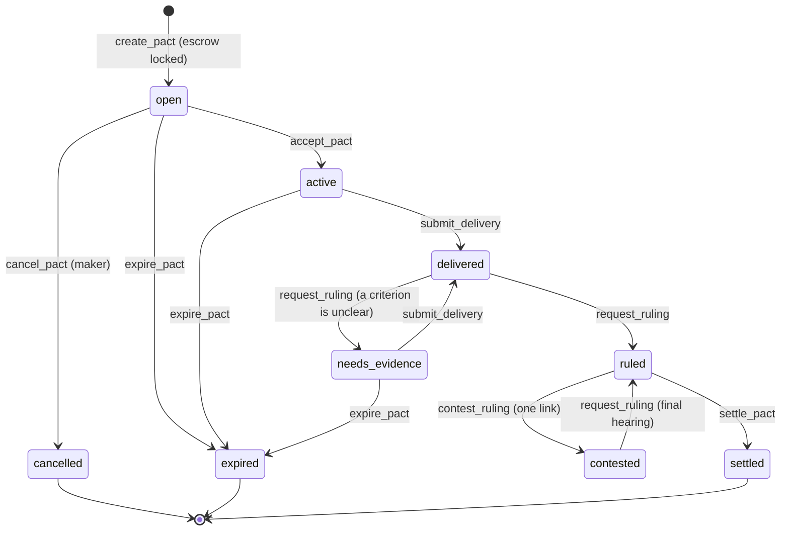

# Tessera

**Agreements in plain words, settled by validator consensus.**
Escrow for work done on the internet, built as an Intelligent Contract on [GenLayer](https://www.genlayer.com) Studionet.

| | |
|---|---|
| **Live app** | <https://tessera-7w7.pages.dev> |
| **Contract** | [`0x02416Ad258690cE1C0640665d3D4a6751BeE35e4`](https://explorer-studio.genlayer.com/address/0x02416Ad258690cE1C0640665d3D4a6751BeE35e4) |
| **Source** | <https://github.com/reza9133/tessera> |
| **Network** | GenLayer Studionet (chain ID 61999) |
| **Explorer** | <https://explorer-studio.genlayer.com> |
| **Licence** | MIT |

> Studionet is a test network and GEN has no value. A consensus of models is a repeatable procedure, not a court, and nothing here is legal advice.

---

## Overview

In ancient Rome a *tessera* was a tablet broken in two. Each party kept a half, and the deal was proved when the halves fit. Tessera does the same for online work, without a middleman:

1. A **maker** writes the deal in plain words, adds a short **rubric** that defines "done", and locks the payment in escrow.
2. A **deliverer** accepts the pact and files public links as evidence.
3. On request, **five validators each fetch the evidence themselves** and rule on every criterion of the rubric.
4. The escrow moves **by ruling**: in full, in proportion to the weight of the criteria met, or back to the maker. One contest is allowed, and the second hearing is final.

Terms, evidence, rulings, payouts and reputation are all on-chain and readable. The contract has **no owner, no admin key and no upgrade path**: money only moves by the rules in [`contracts/tessera.py`](contracts/tessera.py).

## Try it in five minutes

You need a browser and nothing else. The app creates a throwaway account for you and can fund it with test GEN.

1. Open <https://tessera-7w7.pages.dev>. The header should show **Studionet** with a green dot.
2. Click **Connect → Instant burner account**, then open the account menu and click **Get test GEN**.
3. Pick a scenario card on the landing page (for example **The clean delivery**). The pact form opens pre-filled.
4. Optionally click **Test the rubric**. It asks the real validators to read the demo page and costs nothing (a simulation, nothing is written).
5. Click **Lock funds and create the pact** and wait for the transaction.
6. Open the pact URL in a **private window**, connect a second burner account, get test GEN and click **Accept this pact**.
7. File the delivery link for the scenario and click **Request the hearing**. Real consensus takes one to a few minutes.
8. Click **Settle** to release the funds as ruled.

### Demo scenarios

| Scenario | What is delivered | Expected ruling |
|---|---|---|
| **The clean delivery** | A complete page that meets every criterion | Fulfilled, 100% to the deliverer |
| **The short draft** | A page that meets most criteria but falls short on some | Partial, about 83% to the deliverer, the rest back to the maker |
| **The dead link** | A link that does not open | Breached, the escrow returns to the maker |
| **The hijacker** | A page that tries to instruct the judge to approve it | Breached, the injected instruction is ignored |

The evidence pages live in [`public/demo/evidence/`](public/demo/evidence). They must be served from a public origin, because the contract refuses `localhost` and private hosts.

## How a pact works



### The rubric

A rubric has up to five criteria. Each has a **weight** from 1 to 5 and may be marked **required**: if a required criterion fails, nothing is paid.

| Criterion | Decided by | Meaning |
|---|---|---|
| **Link opens** | Code | Every evidence link answers with HTTP 200 |
| **Contains phrase** | Code | The evidence mentions an exact phrase (case and punctuation ignored, any script) |
| **Minimum length** | Code | The evidence has at least *N* words |
| **Judged** | Validators' models | A free-text criterion, for example "The copy covers notes, search and syncing" |

### Payout

The deliverer is paid `met weight × 10000 // total weight` basis points of the escrow, and the remainder returns to the maker. The two parts always add up to the escrow exactly, including for stakes beyond 2^53 (property-tested).

| Outcome | Result |
|---|---|
| `fulfilled` | Everything goes to the deliverer |
| `partial` | Split in proportion to the weight of the criteria met |
| `breached` | Everything returns to the maker (also when a required criterion fails) |
| `needs_evidence` | No money moves; the deliverer may add evidence |

### Time rules

- A pact has a **deadline** of 1 to 90 days and an optional **contest window** of 0, 1, 6, 24 or 72 hours.
- With a contest window, either party can add one link after a ruling and force a final hearing in which `unclear` counts as `unmet`. Settlement waits for the window to close.
- If nobody delivers in time, anyone can call `expire_pact` and the escrow returns to the maker.
- Only the parties may request a hearing until the deadline plus three days; after that anyone may. Nothing can be held hostage.

## Design

| | |
|---|---|
| **Only words cross consensus** | For each criterion, validators agree on one of `met`, `unmet` or `unclear`. Quotes, hashes and prose never do. A validator accepts the leader's ruling only if every verdict equals its own. |
| **Code decides what code can** | *Link opens*, *contains phrase* and *minimum length* are decided by plain code, identically on every validator. Only *judged* criteria use a model. |
| **Asked twice, in opposite orders** | A judged criterion is put to the model twice, with criteria, verdict words and evidence reordered. If the answers differ the verdict is `unclear`, so a bias towards whatever comes first becomes a visible disagreement instead of a silent error. |
| **Evidence is fenced** | Page text, links, terms and criteria are fenced before they reach a model. The prompt has exactly one evidence block that no page can forge a delimiter for (tested). |
| **Integer money** | No floats, no `datetime`, no true division anywhere in the contract. |
| **Refusals refund, never strand** | A refused payable call returns the funds and records the reason in a refusal ledger, which the interface reads instead of parsing receipts. |
| **No admin, no upgrade** | If a bug is found the fix is a new contract and a new address. For a contract that holds other people's escrow, an upgrade key is a larger risk than a bug. |

The reasoning behind each choice, and what it costs, is in [`DECISIONS.md`](DECISIONS.md).

## Contract interface

All methods return a JSON string, so the browser never depends on how an SDK decodes maps or large integers. Amounts are decimal strings.

| Method | Kind | Who | Purpose |
|---|---|---|---|
| `create_pact` | write, payable | anyone | Draft a pact and lock the escrow |
| `accept_pact` | write | the named counterparty, or anyone if none was named | Take the job (not the maker) |
| `cancel_pact` | write | the maker | Take back an unaccepted pact |
| `submit_delivery` | write | the deliverer | File an evidence link |
| `request_ruling` | write | the parties, or anyone after deadline + 3 days | Hold a hearing |
| `contest_ruling` | write | either party | Add one link and ask for the final hearing |
| `settle_pact` | write | anyone, once the contest window is over | Move the money as ruled |
| `expire_pact` | write | anyone, after the deadline | Return the escrow to the maker |
| `preview_hearing` | view | anyone | Free simulation of a hearing on a given link |
| `get_pact`, `list_pacts`, `get_standing`, `get_refusal`, `get_stats`, `rules` | view | anyone | Read state |

## Repository layout

```
contracts/tessera.py          the Intelligent Contract (Studionet runner, `from genlayer import *`)
public/                       the website: static files, no build step
  assets/js/rules.js          the contract's arithmetic, mirrored for previews (tested against the contract)
  assets/js/chain-live.js     genlayer-js adapter for Studionet
  assets/js/chain-sandbox.js  the whole product in the browser: same rules, keyword judge
  assets/js/chamber.js        the hearing-chamber animation
  demo/evidence/              public pages the demo scenarios ask validators to read
functions/api/                Cloudflare Pages Functions: /api/config, /api/status
tests/                        129 contract tests, an SDK stub, golden vectors, JS mirror tests
tools/                        mutation tester, vector generator, OG image generator
scripts/                      deploy.mjs, smoke.mjs (on-chain acceptance test), vendor-sdk.mjs
```

## Run it locally

```bash
npm install            # only needed for the scripts and wrangler; the site itself has no build
npm test               # 129 contract tests + the JS mirror against 800+ golden vectors
npm run mutate         # 66 deliberate bugs; every one must be caught
npm run dev            # local preview with the Pages Functions
```

The site starts in **sandbox mode** when no contract address is configured: the whole product runs in the browser with the same rules and a keyword judge standing in for the validators. Every sandbox ruling says so. A `?contract=0x…` query parameter overrides the address for one session.

> The sandbox, like the contract, refuses `localhost` links, so scenario evidence only works once the site is on a public origin.

## Deploy your own

### 1. Deploy the contract to Studionet

**In the browser.** Open <https://studio.genlayer.com>, create a contract, paste `contracts/tessera.py`, choose *Studionet*, deploy (there are no constructor arguments) and copy the address.

**From the terminal.**

```bash
npm run deploy:contract      # deploys with a throwaway key and writes CONTRACT_ADDRESS into wrangler.toml
```

> **Runner header.** Line 1 of the contract is `# { "Depends": "py-genlayer:1jb45aa8…" }`, the runner stable Studionet (chain 61999) uses. Studio-dev (chain 61997) uses a different runner and SDK import; this contract is deliberately not written for it. If Studio reports the runner as invalid, copy the first line from any example contract in the Studio UI.

### 2. Deploy the site to Cloudflare Pages

```bash
npx wrangler login
# set CONTRACT_ADDRESS = "0x…" in wrangler.toml
npx wrangler pages deploy
```

Or connect the Git repository in the Cloudflare dashboard with **framework preset: None**, **build command: empty** and **build output directory: `public`**. `functions/` is picked up automatically. `.github/workflows/deploy.yml` deploys on every push to `main` (it needs `CLOUDFLARE_API_TOKEN` and `CLOUDFLARE_ACCOUNT_ID`).

`/api/config` serves the public settings, so pointing the site at a new contract is a variable change, not a code change:

| Variable | Default | Meaning |
|---|---|---|
| `CONTRACT_ADDRESS` | *(empty = sandbox)* | the deployed Tessera contract |
| `RPC_URL` | `https://studio.genlayer.com/api` | GenLayer RPC |
| `CHAIN_ID` | `61999` | Studionet |
| `EXPLORER_URL` | `https://explorer-studio.genlayer.com` | block explorer |
| `NETWORK_NAME` | `GenLayer Studionet` | label |

The address of the live deployment is also stored in `public/config.json` as the static fallback.

### 3. Prove it on the real network

```bash
CONTRACT=0x02416Ad258690cE1C0640665d3D4a6751BeE35e4 SITE=https://tessera-7w7.pages.dev npm run smoke
```

Two fresh accounts run a whole pact: create, accept, deliver the clean page, hold a real hearing, settle and check the payout. Expect a few minutes. On Windows PowerShell set the variables first with `$env:CONTRACT="0x…"; $env:SITE="https://…"`.

## Testing

| Layer | How |
|---|---|
| Contract logic | 129 tests against an SDK stub; 66 of 66 mutants killed (`tests/MUTATIONS.md`) |
| Runtime source rules | AST tests: no floats, no `datetime`, no true division, annotated public methods returning `str`, valid storage types, closures never touch `self` |
| UI arithmetic = contract arithmetic | The JS mirror is tested on golden vectors generated from the contract (decisions, splits, standing, links, rubrics, text folding) |
| Whole interface | Driven end to end in Chromium (desktop, mobile and both themes) against the sandbox: create, accept, deliver, hearing, settle, all four scenarios |
| Real network | Run end to end on the live Studionet deployment with real validators: create, accept, deliver, hearing, settle. Repeat it any time with `npm run smoke`, or run the scenarios in the live app |

CI runs the test suite on every push (`.github/workflows/ci.yml`).

## Security and trust model

- **No privileged account.** There is no owner, pause switch or upgrader. The contract source is the whole rulebook.
- **Evidence must be public.** Links to private or local hosts are refused, including numeric spellings of an address (decimal, hex, octal), `.localhost`, `.lan` and similar.
- **Prompt-injection resistant by construction.** Evidence is data, never instructions, and code-decided criteria cannot be argued with.
- **Test funds only.** The instant burner account keeps its key in the browser's `localStorage`. The UI says so. Use a wallet for anything you care about.
- **Hardening.** `npm run vendor` bundles `genlayer-js` into `public/vendor/genlayer.js`, which the app prefers over esm.sh; you can then remove `https://esm.sh` from `script-src` in `public/_headers`. That file ships a strict CSP, so extend `connect-src` if you change the RPC or add a service.

### Known limits

- A judged criterion is only as good as the validators' models, and a page that changes between reads can make a ruling `unclear`.
- One escrow per pact, one currency (GEN), and no partial release before a ruling.
- Standing counts only decided pacts and is easy to restart with a new address: it is a signal, not an identity.

## Troubleshooting

| Symptom | Fix |
|---|---|
| The site shows **Sandbox** | `CONTRACT_ADDRESS` is empty or not a 42-character address. Open `/api/config` to check what the site serves. |
| Banner says Studionet did not answer | The RPC or esm.sh was unreachable. Use **Retry Studionet** in the banner. |
| A hearing "finished but changed nothing" | Validators disagreed or the judge failed (`[LLM_ERROR]`). No state is written before consensus, so nothing is lost. Try again. |
| Scenario evidence is refused | Evidence must be on a public origin. It does not work from `localhost`. |
| Deploy says the runner is invalid | See the runner note above. |

## Documentation

- [`DECISIONS.md`](DECISIONS.md): the non-obvious design choices and their costs
- [`CHANGES.md`](CHANGES.md): changes from the bug review
- [`tests/MUTATIONS.md`](tests/MUTATIONS.md): the mutation-testing report

## Licence and brand

Code: MIT, see [`LICENSE`](LICENSE). The Tessera mark and wordmark are original. The GenLayer logo (`public/assets/brand/genlayer-logo-black.svg`) is GenLayer's trademark, used only to say the project is built on GenLayer; follow their brand guidelines if you change how it is shown.
